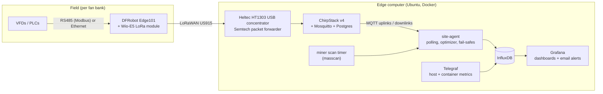

# edge-stack: a LoRaWAN edge stack for fan control

> **Archived.** This is the Dec 2025 – Jan 2026 version of the edge stack.
> The provisioning, health checks and SSH lockdown grew into
> [ipc-stack](https://github.com/neddia/ipc-stack), and the control software
> became site-agent. It's kept here as a record of the LoRaWAN design. It isn't maintained.

One edge computer per site runs everything needed to read and command VFD-driven
cooling fans over LoRaWAN. The VFDs and PLCs connect over RS485 or Ethernet to
small field nodes. The field nodes report over LoRa to a gateway on the edge
computer. The site agent on that computer decides fan speeds and sends the
commands back the same way.

The system is split across three places:
- **This repo:** the edge computer's stack.
- **[edge101-lorawan-node](https://github.com/neddia/edge101-lorawan-node):**
  the field-node firmware (ESP-IDF, C), including the E2 binary protocol.
- **[`site-agent-e2/`](site-agent-e2/):** the host side of that protocol,
  taken from site-agent before LoRaWAN was removed.

## What it does

- **Brings up the radio side.** `scripts/setup-lora-gateway.sh` fetches and builds
  the Semtech `sx1302_hal` and installs a udev rule so the concentrator always
  appears as `/dev/ht1303-0`. It reads the gateway EUI from the chip, retrying
  with a timeout, then writes the packet-forwarder config and installs the
  forwarder as a systemd service.
- **Registers every device in ChirpStack.** `scripts/cs-seed.py` creates the
  gateway, the application, the device profile and each node from a YAML file.
  It's idempotent: re-running it updates a device profile that has drifted
  instead of skipping it.
- **Keeps credentials scoped.** InfluxDB first-boot setup runs inside Compose.
  A one-shot init container then mints a read/write token for the agent's
  bucket only. Admin credentials stay in a per-site "site pack" that never
  goes in git.
- **Watches itself.** Grafana comes pre-provisioned with dashboards for host
  and container health, plus site-agent health: miner fleet seen vs. expected,
  poll errors, data staleness, and how often the optimizer is publishing
  plans. It also has alert rules for CPU, memory, disk and a miner-fleet
  shortfall over 30%.
- **Starts from one command.** `scripts/bootstrap-lite.sh` brings up the data,
  LoRaWAN and app stacks in order. It creates the ChirpStack API key through
  the CLI, seeds the devices, and loads the site-agent image from a tarball,
  so a site doesn't need registry access.

## Control and fail-safes (from `site-pack/storage/site-config.example.yml`)

- **Safe speed on lost contact.** Each VFD has a `safe` block (`hz: 48`,
  `ttl_s: 15`). If a node gets no fresh command within 15 seconds, the fans
  drop to 48 Hz, a known-safe speed.
- **Optimizer limits.** Every 5 minutes the optimizer fits recent data and picks
  fan speeds, inside hard limits: a min/max Hz, a ramp limit, a deadband so
  it doesn't chase noise, and a cap on how fast it can raise speed to handle
  a hotspot.
- **Redundant nodes.** Field nodes are configured in primary/secondary pairs.
  Each node has a preferred link (LoRa) and an optional Ethernet fallback.

## Layout

| Path | What's in it |
|---|---|
| `edge-stacks/data/` | InfluxDB (setup + token init), Grafana (dashboards, alerts), Telegraf |
| `edge-stacks/lorawan/` | Override for the upstream [chirpstack-docker](https://github.com/chirpstack/chirpstack-docker) repo (cloned here by bootstrap), US915 region config |
| `edge-stacks/app/` | site-agent container |
| `site-pack/` | Per-site config and secrets template (real values stay off-box) |
| `scripts/` | Gateway setup, bootstrap, ChirpStack seeding, site-pack generator, miner scan |
| `site-agent-e2/` | Host side of the E2 protocol: encoders, fragmenting, LoRa/TCP dispatch, provisioning, ingest, tests (reference only) |
| `early/pid-infra/` | The Aug 2025 first version, with its history ([notes](early/pid-infra/NOTES.md)) |

[SETUP.md](SETUP.md) has the full per-site order of operations.

## History

| When | Version | What changed |
|---|---|---|
| Aug 2025 | [`early/pid-infra/`](early/pid-infra/) | First boot script: Tailscale, UFW, Docker, InfluxDB + ChirpStack, a daily self-test |
| Sep 2025 – Jan 2026 | [edge101-lorawan-node](https://github.com/neddia/edge101-lorawan-node) | Field-node firmware: E2 v2 protocol, node-run polling, safe-speed fallback |
| Dec 2025 | edge-stack | Separate Compose stacks per concern, the site-pack model, gateway and device seeding |
| Jan 2026 | edge-stack | Hardened gateway bring-up, CLI-based ChirpStack keys, monitoring and alerts |
| Later | [ipc-stack](https://github.com/neddia/ipc-stack) + site-agent | Provisioning, health, lockdown and end-to-end tests; LoRaWAN dropped |

## Known gaps (why it's archived, not "done")

- Tailscale enrollment and OS credentials are still manual steps.
- Services publish their ports (3000, 8000, 8086) on every interface. A real
  deployment should bind them to localhost or the Tailscale interface.
- The stack scripts have no automated tests. The host-side E2 code has
  integration tests in `site-agent-e2/tests/`, and ipc-stack added an
  end-to-end test suite.
